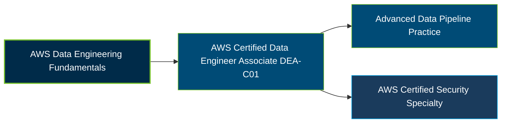

# AWS Certified Data Engineer - Associate (DEA-C01) Certification Exam Guide

A dedicated, comprehensive study guide and data engineering reference repository for candidates preparing for the **AWS Certified Data Engineer - Associate (DEA-C01) Certification Exam**.

---

## Exam Overview

The AWS Certified Data Engineer - Associate certification validates skills in implementing data pipelines, transforming data, selecting data stores, managing data lifecycles, ensuring data quality, and optimizing data operations on AWS.

- **Exam Format**: Multiple-choice and multiple-response questions; testing center or online proctored exam
- **Target Audience**: Data engineers, data architects, analytics engineers, and professionals managing AWS data pipelines and data stores
- **Prerequisites**: No formal prerequisite; AWS recommends 2–3 years of data engineering experience and 1–2 years of hands-on AWS experience

---

## Core Exam Domains & Knowledge Areas

### 1. Data Ingestion and Transformation

- Ingest data from batch, streaming, and API-based sources.
- Transform and process data using appropriate AWS services.
- Orchestrate data pipelines and apply programming concepts.

### 2. Data Store Management

- Select suitable data stores based on workload and access requirements.
- Design data models, manage schemas, and catalog datasets.
- Manage data lifecycles and optimize storage choices.

### 3. Data Operations and Support

- Monitor, troubleshoot, and maintain data pipelines.
- Analyze pipeline performance and optimize cost and reliability.
- Validate data quality, consistency, and operational outcomes.

### 4. Data Security and Governance

- Implement authentication, authorization, and access controls.
- Apply encryption, privacy, logging, and data protection practices.
- Support data governance, compliance, and secure data management.

---

## Certification Path

This is a suggested learning progression, not a mandatory certification sequence. AWS identifies Security - Specialty as a possible next step for data professionals seeking to deepen their cloud security and governance expertise.

---

## Recommended Practice & Study Resources

Combine official AWS exam preparation materials with practical exercises in data ingestion, transformation, storage, monitoring, and governance.

- **CertsGate**: Explore [DEA-C01 certification preparation resources](https://certsgate.com/exams/amazon/amazon-dea-c01) for supplementary study materials and practice questions.
- **Practical AWS Study**: Use the [AWS Glue documentation](https://docs.aws.amazon.com/glue/) to explore data integration, cataloging, transformation, and data pipeline workflows.
